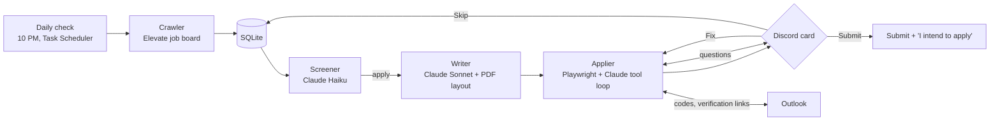

# InternIQ

**An AI agent that finds, screens, and applies to co-op jobs for me, and asks before it submits anything.**

Every night InternIQ reads new Software Engineering postings on my university's job board,
decides which ones fit my rules, writes a tailored resume and cover letter for each, fills
out the employer's application site (Workday, iCIMS, Greenhouse, Oracle, ADP, and more),
and sends me a Discord card. Nothing is submitted until I tap **Submit**.

| | |
|---|---|
| Applications submitted | **39**, across 11 kinds of application sites plus email and the job board itself |
| Screening agreement | I agreed with **13 of 13** of the screener's skip decisions |
| My part in each application | read one card and tap once |

## How it works



1. **Crawl.** A polite crawler (one session, 6 to 12 seconds between pages, at most 15 new
   postings a day, stops at once on any block) saves new postings to SQLite.
2. **Screen.** Claude Haiku reads each posting against my written rules (term dates,
   location, field, eligibility) and returns a structured decision. Learning mode sends every
   skip to Discord for review, and my answers become examples for the next run.
3. **Write.** Claude Sonnet drafts a resume focus and cover letter from a facts file. The
   agent may only claim what that file says. Automatic checks (length, margins, banned
   claims, repeated projects) send the draft back for up to two fixes before it's rendered
   to PDF with reportlab.
4. **Apply.** A site driver opens the application in a real browser. Claude fills each page
   through a small set of tools (`fill_text`, `select_option`, `choose_radio`,
   `upload_file`, `ask_ali`, ...). Every tool reads the page back and reports what actually
   stuck, so the model corrects itself instead of assuming. The model has no submit tool.
5. **Approve.** At the final page the agent posts a Discord card: screenshots, a read-back of
   every answer, the files attached, and any legal answers to confirm. **Submit** presses the
   button once; **Fix** takes a plain-English correction and edits the live form; **Skip**
   becomes a screening example.

## Site drivers

Each driver exposes the same small interface (`read_page`, `fill_text`, `select_option`,
`upload`, `next_page`, `is_review`, `submit`, ...), so the filler doesn't care which site
it's on.

| Driver | Sites | Notable problems solved |
|---|---|---|
| `workday` | AltaGas | date widgets, "Something went wrong" pages, account sign-in |
| `icims` | AMD (8 applications) | iframes, a shared profile resume replaced per job |
| `avature` | Electronic Arts | multi-page final steps, each with its own approval |
| `eightfold` | Lockheed Martin | comboboxes whose options only exist while open |
| `greenhouse` | Astera Labs | react-select, emailed one-character code boxes |
| `raise_jobs` | Enbridge | Salesforce shadow DOM |
| `oracle` | Seaspan | pill buttons, address search that wipes itself, resume import |
| `generic` | BambooHR, ADP, Oleeo, company pages | anything without its own driver (below) |

The **generic driver** handles sites it has never seen. It reads labels from each field's
surroundings, opens custom dropdown menus, answers popups with their own buttons, creates
accounts, follows email verification links, reads emailed codes from Outlook, finds Yes/No
questions hidden inside web components from the site's own error message, and gives every
"Submit" that might not be final its own approval card.

### Sites that don't allow automation

Some application systems detect automated browsers and refuse the submission even after
every field is filled correctly. The agent never tries to get around these checks: it
recognises the refusal, posts a "submit it yourself" card with the link, the PDFs, and
every answer it prepared, and records the site so the next application there goes
straight to me.

| System | What it does at Submit |
|---|---|
| Lever (e.g. GeoComply) | "There was an error verifying your application" |
| Patry Group's own form | "Our spam check stopped this submission" |
| BambooHR (Convverge) | an "I'm not a robot" box that I tick myself before the agent presses Submit |
| Job board (Elevate) | blocked the bundled test browser until the crawl was slowed down and moved to a normal Chrome session, after checking with the board's team |

## Safety rules the agent can't break

- **No submission without my tap.** The submit function checks the database for my approval
  itself, so a model mistake can't submit.
- **No invented experience.** Resumes, letters, and form answers come only from a facts file
  and an answer bank. Anything new is asked on Discord and saved.
- **Legal and attestation answers** (work authorization, background checks, "I certify") are
  always shown on the card for me to confirm.
- **CAPTCHAs and bot checks are never solved by the agent.** It pings me and waits.
- **Polite to the job board.** Low request counts, real pauses, one session, stop on a block.
  Automated access was confirmed with the job board's team first.
- **Secrets and personal data stay out of git**: API keys, passwords, the answer bank, the
  facts file, resumes, and transcripts live in ignored files only.

## Stack

Python 3.12 · Playwright · Anthropic API (Claude Haiku for screening, Claude Sonnet for
writing and form filling, structured outputs and tool use) · discord.py · SQLite ·
reportlab + pypdf · Windows Task Scheduler

## Project layout

```
interniq/
  elevate/      crawler, "I intend to apply", applying inside the job board
  screener.py   apply / skip decisions
  writer/       resume + cover letter drafting, checks, PDF layout
  applier/      filler (Claude tool loop), run loop, one driver per site, email applications
  outlook.py    emailed codes, verification links, sending approved email applications
  discord_bot.py  cards, buttons, questions, !status / !pause / !resume / !run
scripts/        daily check launcher, Task Scheduler setup
```

More detail: [ARCHITECTURE.md](ARCHITECTURE.md) (components and data flow),
[RULES.md](RULES.md) (the agent's decision rules), [BUILDORDER.md](BUILDORDER.md)
(how it was built, phase by phase).

## Setup (Windows)

```
py -3.12 -m venv .venv
.\.venv\Scripts\activate
pip install -r requirements.txt
python -m playwright install chromium
copy .env.example .env                               # API key, Discord token, channel ids
copy config\answers.example.yaml config\answers.yaml # your form answers
python -m interniq ping                              # posts "InternIQ is alive" in Discord
powershell -File scripts\setup_tasks.ps1             # daily check at 10 PM + bot at logon
```

Fonts for the resume and cover letter go in `data/base/fonts/`: Carlito and Roboto
(Regular, Bold, Italic, BoldItalic).

## Commands

```
python -m interniq daily              # crawl + screen + one Discord summary (what the scheduler runs)
python -m interniq crawl              # save new postings and check employer links
python -m interniq screen             # apply / skip decisions, review cards in Discord
python -m interniq write <id> [ids]   # build resume + cover letter into data/output/<id>/
python -m interniq apply <id> [ids]   # fill the application, submit only after approval
python -m interniq email <id> [ids]   # email applications: approve on Discord, sent from Outlook
python -m interniq dryrun <id> <url>  # fill a decoy job on the same site, stop before submit
python -m interniq intend [id]        # click "I intend to apply" on the job board
python -m interniq bot                # Discord bot (normally started at logon)
```
